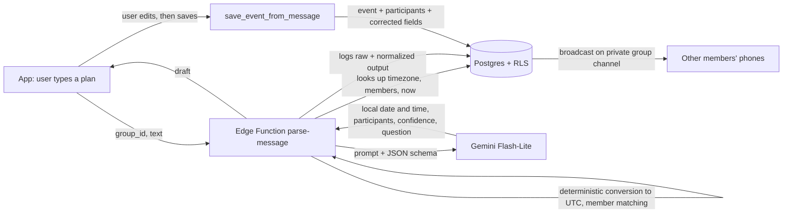

# Family Calendar NLP

A shared calendar app for family and friends where people write plans the way they'd text them, in French, English or Arabic, and an LLM turns each message into a calendar event:

> "Dîner chez Sara jeudi 19h" · "Mom's flight lands Dec 20 at 2pm" · "موعد عند الطبيب غدا الساعة ١٠:٣٠"

Built as a personal project used by my family, and as a data science project. Every message, what the model understood and what the user corrected are logged as a labeled dataset for measuring parsing accuracy.

**Stack:** React Native (Expo, TypeScript) · Supabase (Postgres with Row Level Security, Auth, Realtime, Edge Functions on Deno) · Google Gemini (Flash-Lite)

## Features

- **Natural-language events:** type a plan, then check and edit what the assistant understood (title, date, time, place, participants) before saving. Ambiguous or non-event messages get a clarifying question instead of a guess.
- **Groups and invitations:** create a group, invite people with a 7-day code or link.
- **Shared calendar with live updates:** week and upcoming views. Changes appear on every member's phone within about a second.
- **Timezone-aware throughout:** each person sees times in their own timezone, and all-day events stay on their date for everyone.
- **Find a time:** pick people, a duration and a period, and get the 3 best slots where everyone is free within their *own* local hours. Busy times are shared without revealing what or where. Trips (all-day events with a place) block a person, except for plans in that same place.

## How a message becomes an event



Design choices that matter for accuracy:

- **The model never does timezone math.** It returns *local* wall-clock date and time (for example `2026-10-30` `18:00`), and deterministic code converts to UTC with the author's timezone. This avoids a common LLM failure mode, and it's covered by tests across daylight-saving changes.
- **Grounding for relative dates.** The prompt includes the current local date and time and a 21-day calendar with weekdays, so "jeudi prochain", "in two weeks" or "بعد غد" resolve against explicit dates.
- **Structured output.** A JSON schema constrains the response, and the server validates and coerces every field (impossible dates, malformed times, out-of-range confidence).
- **Calibrated abstention.** Missing information or genuine ambiguity, such as "next Friday" said early in the week, lowers the confidence below a threshold, and the app shows the model's question instead of silently guessing.
- **Context comes from the server.** The app only sends the text; the function looks up the author's timezone, the group members and the current time, so the client can't send a fake context.

## Evaluation

`npm run eval` runs a hand-written set of **41 messages** (19 French, 14 English, 8 Arabic, including Moroccan Darija) through the exact production parsing code, with a fixed reference time, and scores each field.

| Run | Model | Prompt | Fully correct | FR | EN | AR | Median latency |
|---|---|---|---|---|---|---|---|
| 1 | gemini-3.5-flash-lite | v1 | 38/40 | 17/18 | 13/14 | 8/8 | 1.1 s |
| 2 | gemini-3.5-flash-lite | v2 | 41/41 | 19/19 | 14/14 | 8/8 | 1.2 s |

Fields scored: event or not, date, start and end time, all-day, location, participants, UTC start (full pipeline including timezone conversion), and whether low confidence was correctly raised.

Caveats, stated plainly:
- The set is small and was written by me, so it measures whether the parser handles the expressions I designed it for, not real-world accuracy.
- LLM outputs vary between runs. A borderline case ("Qui veut venir ce soir ?", confidence exactly at the threshold) passed in one run and failed in another.
- v2 changed the rule for ambiguous "next <weekday>" to ask rather than guess. The test for that case accepts either date as long as the question is raised.

**Real-world accuracy** comes from the in-app dataset instead. Each message stores the raw model output, the normalized event, the prompt and model versions, the latency, the user's decision (saved or discarded), and, when the user edited the draft, the exact fields they corrected. Analyzing that dataset is the next step of the project.

## Security model

- **Row Level Security on every table:** users only see groups they belong to. A SQL check script (`npm run db:test`) impersonates test users and verifies 44 rules, for example that an outsider can't read another group's events, members can't edit each other's events, drafts stay private and live updates only reach members.
- **No secrets in the app:** the only client config is the Supabase URL and publishable key. The Gemini key lives in Supabase secrets and is used only inside the Edge Function.
- **The dataset can't be tampered with:** users can't insert parsed messages (only the Edge Function can), and after insert they can update only the decision fields, never the model output.
- **Joining a group** only happens through an invite code checked by a database function.
- **Live updates** use private Realtime Broadcast channels authorized by RLS.

## Project structure

```
src/app/                         screens (Expo Router): auth, groups, feed, calendar, event, find-a-time
src/components/, src/lib/        UI components, Supabase client, auth, realtime hook, date helpers
supabase/migrations/             schema, RLS policies, RPCs (SQL)
supabase/tests/rls_check.sql     security checks (PASS/FAIL per rule)
supabase/functions/parse-message parse.ts (prompt, Gemini call, validation, normalization), index.ts (HTTP handler), eval/
supabase/functions/_shared/      zoned-time.ts (timezone math), find-slots.ts (slot ranking), with unit tests
```

## Run it yourself

You need Node 20+, a free [Supabase](https://supabase.com) project, a [Gemini API key](https://aistudio.google.com) and the Expo Go app on your phone.

```bash
npm install
cp .env.example .env                      # Supabase URL + publishable key
npx supabase login
npx supabase link --project-ref <ref>
npm run db:push                           # apply the schema
cp supabase/functions/.env.example supabase/functions/.env   # Gemini key
npx supabase secrets set --env-file supabase/functions/.env
npm run functions:deploy
npx expo start                            # scan the QR code with Expo Go
```

Checks: `npm run typecheck`, `npm run lint`, `npm test` (18 offline unit tests), `npm run db:test` (security), `npm run eval` (parser accuracy).

## Roadmap

- Analysis of the real usage dataset: accuracy by field and language, confidence calibration, effect of prompt versions.
- Standalone builds (EAS) so the app runs without a development server, with real invitation links.
